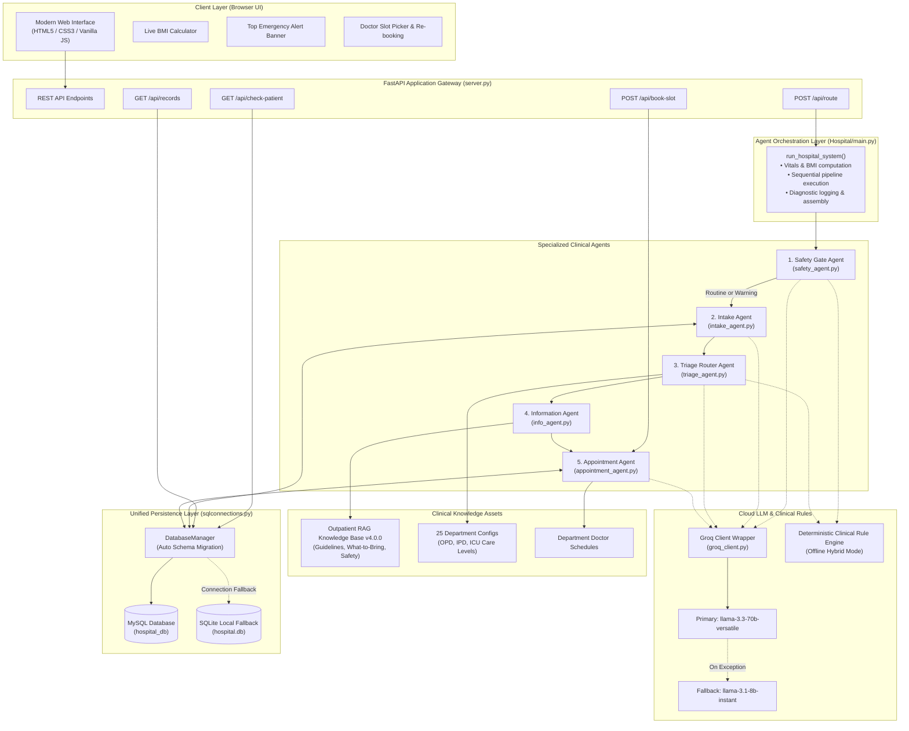
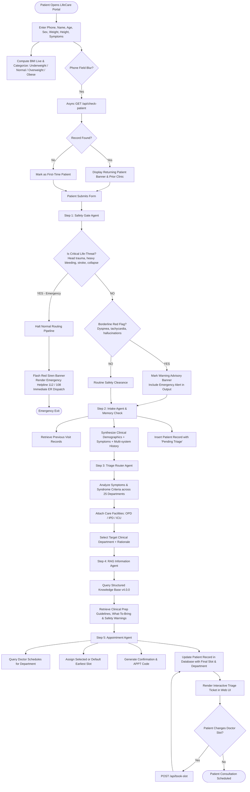
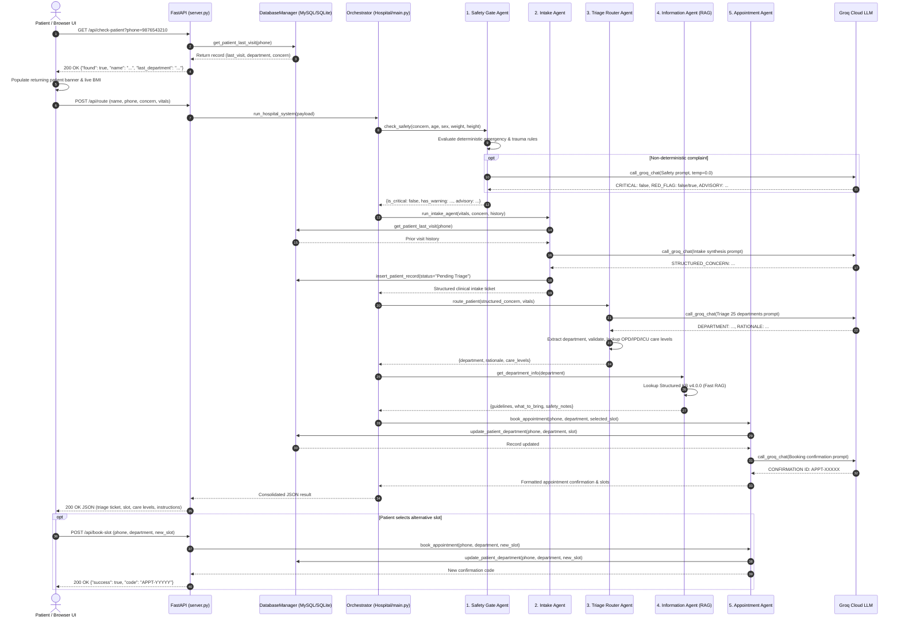
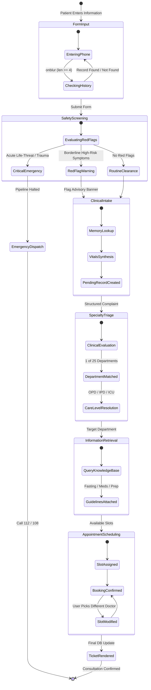
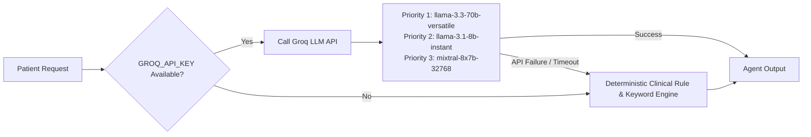

# 🏥 LifeCare Hospital Patient Routing & Clinical Triage AI

> **An intelligent, multi-agent clinical decision support and patient routing system built with FastAPI, Groq LLM reasoning, structured RAG clinical knowledge base, and dual-mode persistence (MySQL / SQLite).**

The **LifeCare Hospital Patient Routing AI** orchestrates a pipeline of 5 specialized clinical AI agents to screen for life-threatening emergencies, recall returning patient history, compute physical vitals (including BMI), route complaints across **25 hospital departments** with **OPD, IPD, and ICU care-tier tracking**, provide department-specific preparation guidance, and automate outpatient doctor appointment scheduling.

> [!IMPORTANT]
> **Clinical Disclaimer**: This application is an educational and engineering demonstration of agentic AI workflows and does **not** constitute a certified medical device, diagnostic tool, or clinical triage service. The safety screening and routing agents do not diagnose medical conditions or prescribe treatment. In a real medical emergency, immediate contact with emergency dispatch services (such as **112** or **108**) or transport to the nearest Emergency Department is mandatory.

---

## ✨ Key Features & Capabilities

- 🛡️ **5-Stage Agentic Pipeline**: Safety Gate $\rightarrow$ Clinical Intake & Memory $\rightarrow$ Specialty Triage Router $\rightarrow$ RAG Information Agent $\rightarrow$ Appointment Scheduler.
- 🚨 **Multi-Tier Emergency Screening**: Deterministic clinical red-flag rules, intracranial trauma combinations, hypovolemic shock detection, and Groq LLM emergency reasoning.
- 🔔 **Dynamic Emergency Alert Banner**: Instant visual flashing alert and quick-dial buttons (`112` / `108`) for critical life-threats and high-risk symptoms.
- 🧠 **Database Memory & History Recall**: Automatically pulls past visits, prior departments, and previous concerns when a patient inputs their phone number.
- 📊 **Demographics & Physical Vitals Support**: Collects Age, Sex, Weight, and Height, calculating real-time **Body Mass Index (BMI)** with clinical categorization.
- 🏥 **25 Hospital Departments**: Complete coverage from General Medicine, Cardiology, and Neurology to Oncology, Rheumatology, and Critical Care, with explicit **OPD**, **IPD**, and **ICU** facility capabilities.
- 📚 **RAG Knowledge Base (v4.0.0)**: Department preparation protocols, global medication safety rules, and "what to bring" instructions.
- ⚡ **Resilient Hybrid Mode**: Operates seamlessly with Groq Cloud LLMs (`llama-3.3-70b-versatile`, `llama-3.1-8b-instant`, `mixtral-8x7b-32768`) and includes an automatic deterministic clinical rule fallback if API keys or networks are offline.
- 🗄️ **Dual-Mode Database**: Automatic connection to enterprise **MySQL** with auto-migration, with instant zero-configuration fallback to local **SQLite** (`hospital.db`).
- 💻 **Interactive Web Interface**: Modern, responsive frontend with live BMI preview, returning patient welcome banner, interactive doctor slot switcher, and printable booking cards.

---

## 📑 Table of Contents

- [Architectural & UML Diagrams](#-architectural--uml-diagrams)
  - [1. System Architecture & Component Diagram](#1-system-architecture--component-diagram)
  - [2. End-to-End Clinical Flowchart](#2-end-to-end-clinical-flowchart)
  - [3. UML Sequence Diagram](#3-uml-sequence-diagram)
  - [4. UML Class & Data Model Diagram](#4-uml-class--data-model-diagram)
  - [5. Clinical State Machine Diagram](#5-clinical-state-machine-diagram)
- [Agent Pipeline Responsibilities](#-agent-pipeline-responsibilities)
- [Hospital Departments & Care Levels](#-hospital-departments--care-levels)
- [Resilient Hybrid Mode & LLM Integration](#-resilient-hybrid-mode--llm-integration)
- [Project Directory Structure](#-project-directory-structure)
- [Getting Started](#-getting-started)
- [Configuration & Environment](#-configuration--environment)
- [HTTP API Reference](#-http-api-reference)
- [Database Schema & Persistence](#-database-schema--persistence)
- [Safety, Privacy & Clinical Compliance](#-safety-privacy--clinical-compliance)

---

## 📐 Architectural & UML Diagrams

### 1. System Architecture & Component Diagram

The following UML Component Diagram illustrates the decoupling between the frontend client, the FastAPI application, the agent orchestration layer, the 5 specialized clinical agents, external Groq LLM inference, local RAG knowledge assets, and the dual-mode persistence layer.



---

### 2. End-to-End Clinical Flowchart

This flowchart maps the complete lifecycle of a patient interaction—from entering vital signs through emergency screening, historical memory recall, clinical triage across 25 departments, RAG instruction retrieval, and appointment confirmation.



---

### 3. UML Sequence Diagram

This sequence diagram details the exact asynchronous message exchange between the Browser Client, FastAPI backend, Database, the 5 pipeline agents, and the Groq LLM service.



---

### 4. UML Class & Data Model Diagram

This diagram displays the object model, API schemas, and data structures used across the application.

```mermaid
classDiagram
    class PatientRequest {
        +str name
        +str phone
        +str patient_concern
        +Optional~int~ age
        +Optional~str~ sex
        +Optional~float~ weight
        +Optional~float~ height
        +Optional~dict~ chosen_slot
    }

    class SlotBookingRequest {
        +str phone
        +str department
        +dict slot
    }

    class DatabaseManager {
        -_mode: str
        +get_connection()
        +get_mode() str
        +_init_mysql_tables(conn)
        +_init_sqlite_tables(conn)
    }

    class PatientRecordEntity {
        +int id
        +str name
        +str phone
        +Optional~int~ age
        +Optional~str~ sex
        +Optional~float~ weight
        +Optional~float~ height
        +Optional~float~ bmi
        +str last_concern
        +str routed_department
        +timestamp visit_date
    }

    class SafetyGateAgent {
        +check_safety(concern, vitals) Dict
        +has_critical_emergency(text) bool
        +has_red_flag_warning(text) bool
        +extract_matched_red_flags(text) List
        +is_emergency(safety_result) bool
    }

    class IntakeAgent {
        +run_intake_agent(name, phone, concern, vitals) str
        +extract_structured_concern(ticket) str
    }

    class TriageRouterAgent {
        +route_patient(concern, vitals) str
        +extract_department(output) str
        +extract_rationale(output) str
        +get_department_care_levels(dept) Dict
    }

    class InformationAgent {
        +get_department_info(department) str
        +get_structured_dept_info(department) Dict
    }

    class AppointmentAgent {
        +get_slots_for_department(department) List~Dict~
        +book_appointment(phone, department, slot) str
    }

    class GroqClientWrapper {
        -_client: Groq
        +get_groq_api_key() str
        +is_groq_available() bool
        +get_groq_client() Groq
        +call_groq_chat(prompt, temp) str
    }

    PatientRequest --> DatabaseManager : Persisted by
    PatientRecordEntity <.. DatabaseManager : Maps to Table
    SafetyGateAgent --> GroqClientWrapper : Uses
    IntakeAgent --> GroqClientWrapper : Uses
    IntakeAgent --> DatabaseManager : Queries & Inserts
    TriageRouterAgent --> GroqClientWrapper : Uses
    AppointmentAgent --> GroqClientWrapper : Uses
    AppointmentAgent --> DatabaseManager : Updates Record
```



---

### 5. Clinical State Machine Diagram



---

## 🤖 Agent Pipeline Responsibilities

| Stage | Agent Name | Source File | Core Responsibilities & Outputs |
|:---:|---|---|---|
| **1** | **Safety Gate Agent** | `Hospital/safety_agent.py` | Acts as an unbypassable gatekeeper. Evaluates complaints using deterministic emergency trauma/head injury rules, intracranial combination rules, cardiovascular/respiratory flags, and Groq LLM clinical screening. **Immediately halts non-urgent routing upon critical detection.** |
| **2** | **Intake Agent** | `Hospital/intake_agent.py` | Performs database memory lookup to pull prior visits. Ingests demographics, age, sex, weight, height, and symptoms, computing BMI and preserving multi-system context. Inserts a new record marked `Pending Triage`. |
| **3** | **Triage Router Agent** | `Hospital/triage_agent.py` | Evaluates complex multi-system complaints against **25 clinical departments**. Maps clinical presentations to appropriate specialties, verifies care facilities (**OPD / IPD / ICU**), and provides medical rationales without prescribing. |
| **4** | **Information Agent** | `Hospital/info_agent.py` | High-speed local RAG clinical knowledge base (v4.0.0). Returns department-specific preparation guidelines, "what to bring" checklists, and critical safety rules (fasting cautions, regular medication rules). |
| **5** | **Appointment Agent** | `Hospital/appointment_agent.py` | Retrieves live doctor schedules, assigns initial available outpatient slots, updates the database record with department and booking details, and formats an official confirmation ticket with an `APPT-XXXXX` code. |

---

## 🏥 Hospital Departments & Care Levels

The triage system routes across 25 recognized clinical departments, evaluating care level capabilities:

| # | Department Name | OPD | IPD | ICU | Key Clinical Scope & Indications |
|:---:|---|:---:|:---:|:---:|---|
| 1 | **General Medicine** | ✅ | ✅ | ❌ | Multi-system illnesses, unexplained fever, fatigue, hypertension, initial diagnostics. |
| 2 | **General Surgery** | ✅ | ✅ | ❌ | Hernias, appendicitis, abdominal lumps, gallbladder pathology, minor surgical excisions. |
| 3 | **Emergency Medicine** | ✅ | ✅ | ✅ | Acute life-threats, massive trauma, acute chest pain, respiratory arrest, poisoning. |
| 4 | **Cardiology** | ✅ | ✅ | ✅ | Palpitations, angina, heart failure, arrhythmias, hypertension, post-MI care. |
| 5 | **Neurology** | ✅ | ✅ | ✅ | Headaches, seizures, neuropathy, Parkinson's, multiple sclerosis, stroke follow-up. |
| 6 | **Neurosurgery** | ✅ | ✅ | ✅ | Brain tumors, spinal disc herniation, intracranial hemorrhage, cranial trauma. |
| 7 | **Orthopaedics** | ✅ | ✅ | ❌ | Bone fractures, osteoarthritis, knee/hip pain, spine disorders, sports injuries. |
| 8 | **Pediatrics** | ✅ | ✅ | ✅ | Infant, child, and adolescent medicine, vaccinations, growth and development. |
| 9 | **Obstetrics & Gynecology** | ✅ | ✅ | ✅ | Antenatal care, menstrual disorders, pelvic pain, maternity, menopause. |
| 10 | **Psychiatry** | ✅ | ✅ | ❌ | Mood disorders, anxiety, depression, psychosis, behavioral medicine, ADHD. |
| 11 | **Dermatology** | ✅ | ❌ | ❌ | Eczema, psoriasis, acne, skin rashes, fungal infections, hair and nail conditions. |
| 12 | **Ophthalmology** | ✅ | ✅ | ❌ | Vision blurring, cataract, glaucoma, conjunctivitis, refraction, diabetic retinopathy. |
| 13 | **ENT (Otolaryngology)** | ✅ | ✅ | ❌ | Ear infections, hearing loss, sinusitis, tonsillitis, vertigo, hoarseness. |
| 14 | **Urology** | ✅ | ✅ | ❌ | Kidney stones, urinary tract infections, prostate enlargement, incontinence. |
| 15 | **Nephrology** | ✅ | ✅ | ❌ | Chronic kidney disease, proteinuria, dialysis management, acute renal impairment. |
| 16 | **Gastroenterology** | ✅ | ✅ | ❌ | Acid reflux, peptic ulcers, liver disease, jaundice, irritable bowel syndrome. |
| 17 | **Pulmonology / Respiratory** | ✅ | ✅ | ✅ | Asthma, COPD, pneumonia, chronic cough, interstitial lung disease, sleep apnea. |
| 18 | **Endocrinology** | ✅ | ✅ | ❌ | Type 1 & 2 diabetes, thyroid disorders, pituitary diseases, metabolic syndrome. |
| 19 | **Rheumatology** | ✅ | ✅ | ❌ | Rheumatoid arthritis, lupus (SLE), gout, autoimmune inflammatory conditions. |
| 20 | **Hematology** | ✅ | ✅ | ❌ | Anemia, thrombocytopenia, bleeding disorders, leukemia, lymphoma workup. |
| 21 | **Oncology** | ✅ | ✅ | ❌ | Solid tumors, cancer staging, chemotherapy coordination, palliative oncology. |
| 22 | **Anesthesiology** | ❌ | ❌ | ✅ | Pre-operative assessment, acute and chronic pain clinics, regional anesthesia. |
| 23 | **Critical Care Medicine** | ❌ | ❌ | ✅ | Multi-organ failure, sepsis, mechanical ventilation, post-cardiac arrest care. |
| 24 | **Dentistry / Oral Surgery** | ✅ | ❌ | ❌ | Toothache, dental caries, root canals, impacted third molars, oral lesions. |
| 25 | **Physiotherapy / Rehab** | ✅ | ✅ | ❌ | Post-stroke rehabilitation, musculoskeletal recovery, gait training, ergonomic therapy. |

---

## ⚡ Resilient Hybrid Mode & LLM Integration

The application features a **zero-downtime resilient hybrid design**:



1. **Cloud LLM Acceleration**:
   - Primary Model: `llama-3.3-70b-versatile`
   - Secondary Fallback: `llama-3.1-8b-instant`
   - Long-Context Tertiary: `mixtral-8x7b-32768`
   - Parameters: Deterministic temperature (`0.0`) for maximum clinical consistency.
2. **Deterministic Clinical Rule Fallback**:
   - If no API key is configured or the cloud service experiences a network outage, the system automatically transitions into **Resilient Hybrid Mode**.
   - Clinical rule matrices in `safety_agent.py` and `triage_agent.py` evaluate complaints against deterministic symptom dictionaries, ensuring continuous operation.

---

## 🗂️ Project Directory Structure

```text
HospitalRoutingAIAgent/
├── server.py                     # FastAPI application, routing endpoints, static mount
├── README.md                     # Comprehensive documentation and UML diagrams
├── .gitignore                    # Git ignore file for Python, logs, and databases
├── .gitattributes                # Repository line endings and attributes
│
├── templates/
│   └── index.html                # Modern patient intake interface & dashboard
│
├── static/
│   ├── css/
│   │   └── styles.css            # Primary stylesheet (glassmorphism, alerts, cards)
│   └── js/
│       └── script.js             # Client-side validation, live BMI, API calls & rendering
│
└── Hospital/
    ├── __init__.py               # Package marker
    ├── main.py                   # Master orchestrator: run_hospital_system()
    ├── safety_agent.py           # Agent 1: Emergency & Red-Flag Gatekeeper
    ├── intake_agent.py           # Agent 2: Demographics, Vitals & Memory Intake
    ├── triage_agent.py           # Agent 3: 25-Department Clinical Syndrome Router
    ├── info_agent.py             # Agent 4: RAG Clinical Knowledge Base v4.0.0
    ├── appointment_agent.py      # Agent 5: Doctor Slots & Booking Confirmation
    ├── groq_client.py            # Resilient Groq LLM client with cascading failover
    ├── sqlconnections.py         # Unified DatabaseManager (MySQL + SQLite fallback)
    └── hospital.db               # SQLite database file (created automatically at runtime)
```

---

## 🚀 Getting Started

### 1. Prerequisites

- Python 3.10 or higher.
- (Optional) MySQL Server 8.0+ (if enterprise database persistence is desired).

### 2. Environment Setup

Clone the repository and create an isolated virtual environment:

**Windows PowerShell**
```powershell
# Navigate to project directory
cd "c:\Users\hp\Desktop\CSE476  AGENTIC AI AND INTELLIGENT AUTOMATION\HospitalRoutingAIAgent"

# Create and activate virtual environment
py -m venv .venv
.\.venv\Scripts\Activate.ps1
```

**macOS / Linux**
```bash
python3 -m venv .venv
source .venv/bin/activate
```

### 3. Install Dependencies

Install the core dependencies:

```bash
pip install fastapi uvicorn groq pydantic
```

*(Optional) For MySQL connectivity:*
```bash
pip install mysql-connector-python
```

> **Note**: If `mysql-connector-python` or a running MySQL server is not detected, the system automatically runs on the integrated SQLite engine (`Hospital/hospital.db`). No configuration is required.

### 4. Configure Environment Variables

To activate cloud agent reasoning via Groq:

**Windows PowerShell**
```powershell
$env:GROQ_API_KEY = "gsk_your_groq_api_key_here"
```

**macOS / Linux**
```bash
export GROQ_API_KEY="gsk_your_groq_api_key_here"
```

*(Optional) Configure MySQL database credentials if applicable:*
```powershell
$env:MYSQL_HOST = "localhost"
$env:MYSQL_PORT = "3306"
$env:MYSQL_USER = "root"
$env:MYSQL_PASSWORD = "your_mysql_password"
$env:MYSQL_DATABASE = "hospital_db"
```

### 5. Launch the Server

Run the application:

```bash
python server.py
```

Or using Uvicorn directly with hot-reload:

```bash
uvicorn server:app --host 127.0.0.1 --port 8000 --reload
```

Open your browser and navigate to:
**`http://127.0.0.1:8000`**

Interactive OpenAPI Swagger documentation is available at **`http://127.0.0.1:8000/docs`**.

---

## 🌐 HTTP API Reference

### `GET /api/check-patient?phone={phone}`

Searches patient registry memory for prior visits using the contact phone number.

**Response (`200 OK` - Found):**
```json
{
  "found": true,
  "name": "Jane Doe",
  "age": 34,
  "sex": "Female",
  "weight": 62.0,
  "height": 168.0,
  "bmi": 22.0,
  "last_visit": "2026-11-15 14:22:10",
  "last_concern": "Persistent knee stiffness after morning run",
  "last_department": "Orthopaedics"
}
```

---

### `POST /api/route`

Executes the full 5-agent clinical screening and routing pipeline.

**Request Body:**
```json
{
  "name": "Jane Doe",
  "phone": "9876543210",
  "patient_concern": "Frequent heart palpitations and dizziness when standing up",
  "age": 34,
  "sex": "Female",
  "weight": 62.0,
  "height": 168.0,
  "chosen_slot": null
}
```

**Response (`200 OK` - Routine / Warning Result):**
```json
{
  "success": true,
  "is_urgent": false,
  "has_warning": true,
  "matched_red_flags": ["palpitations", "dizziness with palpitations"],
  "warning_advisory": "Symptoms warrant close clinical observation. If shortness of breath occurs, seek immediate emergency care.",
  "emergency_helpline": "112 / 108",
  "patient_name": "Jane Doe",
  "phone": "9876543210",
  "age": 34,
  "sex": "Female",
  "weight": 62.0,
  "height": 168.0,
  "bmi": 22.0,
  "is_returning": true,
  "previous_visit": {
    "visit_date": "2026-11-15 14:22:10",
    "last_concern": "Persistent knee stiffness",
    "last_department": "Orthopaedics"
  },
  "department": "Cardiology",
  "rationale": "Cardiac rhythm anomalies or palpitations requiring electrocardiogram and cardiologist evaluation.",
  "care_levels": {
    "opd": true,
    "ipd": true,
    "icu": true
  },
  "structured_instructions": {
    "guidelines": [
      "Avoid heavy caffeinated beverages, energy drinks, or smoking 4 hours prior to visit.",
      "Wear a comfortable, easily openable two-piece shirt or top to facilitate ECG placement."
    ],
    "what_to_bring": [
      "Government Photo ID & LifeCare appointment confirmation.",
      "Past ECG strips, Echo reports, or Holter monitoring records.",
      "Complete list of all ongoing cardiac or blood pressure medications."
    ]
  },
  "booking_options": [
    {
      "doctor": "Dr. K. V. Reddy (DM Cardiology)",
      "time": "Tomorrow at 09:30 AM",
      "room": "Room 401, Cardiac Wing",
      "type": "Cardiology Consultation"
    }
  ],
  "assigned_booking": "CONFIRMATION ID: APPT-CARD-8841",
  "selected_slot": {
    "doctor": "Dr. K. V. Reddy (DM Cardiology)",
    "time": "Tomorrow at 09:30 AM",
    "room": "Room 401, Cardiac Wing",
    "type": "Cardiology Consultation"
  },
  "logs": "..."
}
```

**Response (`200 OK` - Critical Emergency Result):**
```json
{
  "success": false,
  "is_urgent": true,
  "has_warning": true,
  "matched_red_flags": ["Critical Trauma / Acute Life Threat"],
  "emergency_advice": "Critical emergency detected. Do NOT wait for an outpatient appointment. Call emergency dispatch (112 or 108) or report to the nearest hospital Emergency Room immediately.",
  "helpline": "112 / 108",
  "patient_name": "Jane Doe",
  "age": 34,
  "sex": "Female",
  "logs": "..."
}
```

---

### `POST /api/book-slot`

Switches the patient's appointment to an alternative doctor or schedule slot.

**Request Body:**
```json
{
  "phone": "9876543210",
  "department": "Cardiology",
  "slot": {
    "doctor": "Dr. B. Sengupta (MD, DM Interventional)",
    "time": "Tomorrow at 01:00 PM",
    "room": "Room 403, Cardiac Wing",
    "type": "Heart Rhythm & Preventive OPD"
  }
}
```

**Response (`200 OK`):**
```json
{
  "success": true,
  "confirmation": "CONFIRMATION ID: APPT-CARD-9102",
  "code": "APPT-CARD-9102",
  "slot": {
    "doctor": "Dr. B. Sengupta (MD, DM Interventional)",
    "time": "Tomorrow at 01:00 PM",
    "room": "Room 403, Cardiac Wing",
    "type": "Heart Rhythm & Preventive OPD"
  },
  "department": "Cardiology"
}
```

---

### `GET /api/records?limit=25`

Retrieves recent hospital intake and routing records from the database registry.

---

## 🗄️ Database Schema & Persistence

The unified `DatabaseManager` maintains automatic table creation and seamless schema migrations across both MySQL and SQLite:

### `patient_records` Table

| Column | Data Type | Constraint | Description |
|---|---|---|---|
| `id` | `INT` | `PRIMARY KEY AUTO_INCREMENT` | Unique record sequence ID. |
| `name` | `VARCHAR(255)` | `NOT NULL` | Patient full name. |
| `phone` | `VARCHAR(50)` | `NOT NULL` | Indexed contact number for memory retrieval. |
| `age` | `INT` | `DEFAULT NULL` | Patient age in years. |
| `sex` | `VARCHAR(20)` | `DEFAULT NULL` | Patient sex (Male / Female / Other). |
| `weight` | `FLOAT` | `DEFAULT NULL` | Recorded body weight in kilograms (kg). |
| `height` | `FLOAT` | `DEFAULT NULL` | Recorded height in centimeters (cm). |
| `bmi` | `FLOAT` | `DEFAULT NULL` | Derived Body Mass Index ($\text{kg/m}^2$). |
| `last_concern` | `TEXT` | `NOT NULL` | Presenting clinical symptoms described. |
| `routed_department` | `VARCHAR(255)` | `NOT NULL` | Routed department and assigned booking slot details. |
| `visit_date` | `TIMESTAMP` | `DEFAULT CURRENT_TIMESTAMP` | Date and time the intake was recorded. |

---

## 🛡️ Safety, Privacy & Clinical Compliance

1. **Non-Diagnostic Scope**: The agents assist in administrative routing, preparation instructions, and queue management. They do not diagnose diseases or prescribe pharmaceuticals.
2. **Deterministic Emergency Precedence**: Algorithmic rules override LLM text whenever acute cardiovascular, intracranial trauma, or respiratory distress keywords are detected.
3. **Data Protection & Privacy**: Patient health information (PHI) must be handled in compliance with applicable standards (e.g., HIPAA, GDPR, DISHA). Use anonymized synthetic profiles for demonstrations.
4. **Credential Safeguards**: Never commit API keys or database passwords to source control. Always inject credentials via environment variables.

---

<p align="center">
  <b>LifeCare Hospital Patient Routing AI</b><br/>
  <i>Engineered for CSE476 Agentic AI & Intelligent Automation</i>
</p>
