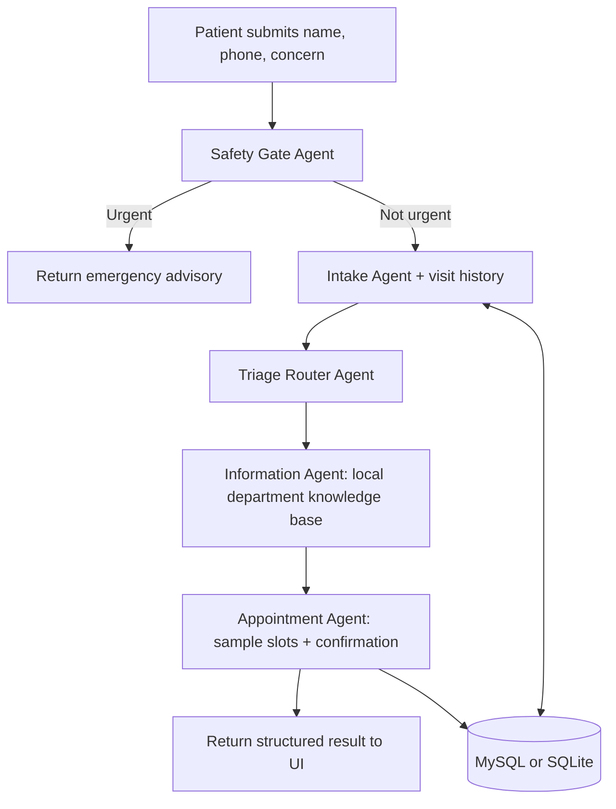

# 🏥 LifeCare Hospital Patient Routing AI

> A FastAPI demonstration of patient intake, emergency-safety screening, outpatient department routing, preparation guidance, and appointment booking.

The application collects a patient's contact details and concern, checks for emergency red flags, and—when the concern is not flagged as urgent—runs an agent pipeline to recommend a department and book a sample outpatient slot. Patient visit history is stored in MySQL when it is available, with a local SQLite fallback.

> [!IMPORTANT]
> **This is a software demonstration, not a medical device or clinical service.** The safety and routing agents do not diagnose conditions or replace professional medical advice. The doctor schedules are sample data, not a live hospital scheduling system. For a real emergency, contact local emergency services or go to the nearest emergency department.

## ✨ At a glance

| Area | Implementation |
|---|---|
| Web/API framework | FastAPI |
| UI | HTML, CSS, and JavaScript served from the `templates/` and `static/` folders |
| Agent model provider | Groq API |
| Primary model | `openai/gpt-oss-120b` |
| Fallback model | `llama-3.3-70b-versatile` |
| Generation temperature | `0.0` for the LLM calls in the agents |
| Persistence | MySQL when connectable; otherwise SQLite |
| Main entry point | `server.py` |

## 📚 Contents

- [How it works](#-how-it-works)
- [Agent responsibilities](#-agent-responsibilities)
- [Project structure](#-project-structure)
- [Getting started](#-getting-started)
- [Configuration](#-configuration)
- [HTTP API](#-http-api)
- [Data storage](#-data-storage)
- [Model details and reported API limits](#-model-details-and-reported-api-limits)
- [Safety, privacy, and production notes](#-safety-privacy-and-production-notes)

## 🔄 How it works

The routing pipeline is sequential. The emergency-safety step is a gate: an urgent response returns immediately and does not proceed to intake, department routing, or booking.



### Routine request sequence

1. The browser calls `GET /api/check-patient` when the phone field loses focus.
2. On form submission, the browser posts the patient information to `POST /api/route`.
3. The Safety Gate Agent checks the concern. If urgent, the response contains an emergency advisory and the normal routing flow stops.
4. If not urgent, the Intake Agent looks up visit history, creates a structured intake summary, and inserts a pending visit record.
5. The Triage Router Agent recommends a department and short rationale.
6. The Information Agent supplies preparation guidelines and a “what to bring” list from a local structured knowledge base.
7. The Appointment Agent selects a sample slot, updates the latest patient record, and generates a confirmation.
8. The UI displays the result. Selecting another slot calls `POST /api/book-slot`.

## 🤖 Agent responsibilities

| Agent | Main function(s) | Responsibility and output |
|---|---|---|
| **Safety Gate Agent** | `check_safety()`, `is_emergency()` in `Hospital/safety_agent.py` | Asks the LLM to screen the patient's own description for emergency red flags. It expects `URGENT` and `ADVISORY` lines. The helper interprets the `URGENT` value. An urgent result stops standard routing; it is not a diagnosis. |
| **Intake Agent** | `run_intake_agent()`, `extract_structured_concern()` in `Hospital/intake_agent.py` | Retrieves the patient's previous visit, asks the LLM to produce a structured intake ticket, extracts the concern for triage, and inserts a new visit with a pending department. |
| **Triage Router Agent** | `route_patient()`, `extract_department()` in `Hospital/triage_agent.py` | Maps the structured concern to a hospital department and a brief rationale. Its prompt explicitly prohibits diagnosis. If the expected department label cannot be parsed, the pipeline uses **General Medicine**. |
| **Information Agent** | `get_structured_dept_info()`, `get_department_info()` in `Hospital/info_agent.py` | Looks up department-specific guidelines and items to bring in a Python dictionary. It does **not** make an LLM request for these details. Unknown departments receive general preparation guidance. |
| **Appointment Agent** | `get_slots_for_department()`, `book_appointment()` in `Hospital/appointment_agent.py` | Looks up hard-coded sample doctor slots, records the selected slot with the patient's latest visit, and asks the LLM to format an appointment confirmation. Unknown departments receive general sample slots. |

The top-level orchestrator, `run_hospital_system()` in `Hospital/main.py`, connects these steps, collects execution logs, and assembles the JSON result for the API.

### LLM behavior

- The Safety, Intake, Triage, and Appointment agents use the Groq Python SDK.
- Their primary model is `openai/gpt-oss-120b`.
- If a primary model call raises an exception, the agent retries that operation with `llama-3.3-70b-versatile`.
- Both primary and fallback calls set `temperature=0.0`.
- Temperature `0.0` favors consistent responses but does not guarantee identical outputs or correctness.

## 🗂️ Project structure

```text
.
├── server.py                    # FastAPI app, routes, and static-file mount
├── templates/
│   └── index.html               # Patient intake UI
├── static/
│   ├── css/
│   │   ├── styles.css           # Styles used by the UI
│   │   └── style.css            # Additional stylesheet in the repository
│   └── js/
│       └── script.js            # Browser-side API calls and rendering
└── Hospital/
    ├── main.py                  # Orchestrates the five-stage pipeline
    ├── safety_agent.py          # Emergency red-flag gate
    ├── intake_agent.py          # Patient intake and memory lookup
    ├── triage_agent.py          # Department routing
    ├── info_agent.py            # Preparation guidance knowledge base
    ├── appointment_agent.py     # Sample slots and booking confirmation
    ├── sqlconnections.py        # MySQL/SQLite persistence
    └── hospital.db              # Created at runtime when SQLite is used
```

FastAPI serves the UI at `/` and mounts files from `static/` at `/static/`. Interactive API documentation is available at `/docs` and `/redoc` while the server is running.

## 🚀 Getting started

### 1. Create and activate a virtual environment

**Windows PowerShell**

```powershell
py -m venv .venv
.\.venv\Scripts\Activate.ps1
```

**macOS / Linux**

```bash
python3 -m venv .venv
source .venv/bin/activate
```

### 2. Install dependencies

There is no dependency manifest in the repository currently. Install the web and model packages with:

```bash
python -m pip install fastapi uvicorn groq
```

For MySQL support, also install the optional connector:

```bash
python -m pip install mysql-connector-python
```

If the MySQL connector is unavailable, the database module uses SQLite.

### 3. Configure the model API key

Set `GROQ_API_KEY` in the environment where the application will run.

**Windows PowerShell**

```powershell
$env:GROQ_API_KEY = "your-groq-api-key"
```

**macOS / Linux**

```bash
export GROQ_API_KEY="your-groq-api-key"
```

The application reads environment variables directly; it does not load a `.env` file itself. Never put a real API key in this README, source code, or a committed environment file. If a credential has been committed to source control, revoke and rotate it.

### 4. Start the server

```bash
python server.py
```

Open <http://127.0.0.1:8000/>. The equivalent Uvicorn command is:

```bash
python -m uvicorn server:app --host 127.0.0.1 --port 8000 --reload
```

The server started by `python server.py` binds to `127.0.0.1:8000`. Use an appropriate production ASGI server and deployment configuration for a hosted environment.

## ⚙️ Configuration

| Environment variable | Purpose |
|---|---|
| `GROQ_API_KEY` | API key used by the Groq SDK clients in the LLM-backed agents. |
| `MYSQL_HOST` | MySQL server host. |
| `MYSQL_PORT` | MySQL server port; parsed as an integer. |
| `MYSQL_USER` | MySQL username. |
| `MYSQL_PASSWORD` | MySQL password. |
| `MYSQL_DATABASE` | Database name used for patient records. |

The application attempts MySQL when the connector is installed and the server is reachable. If that connection attempt does not succeed, it falls back to `Hospital/hospital.db`. The `patient_records` table is created automatically in the selected database.

## 🌐 HTTP API

All API request and response bodies use JSON except for query parameters. FastAPI validates the request models; invalid request bodies generally receive `422 Unprocessable Entity`. The examples below are illustrative—LLM-generated text, appointment IDs, and slot contents can vary.

### `GET /`

Serves the patient intake page as HTML.

**Success:** `200 OK`, `text/html`

### `GET /static/{path}`

Serves frontend assets from the `static/` directory, such as `/static/css/styles.css` and `/static/js/script.js`.

### `GET /api/check-patient?phone={phone}`

Looks up the most recent record for a phone number. The endpoint trims whitespace and returns `{"found": false}` when the cleaned number has fewer than four characters or no matching record exists.

**Found — `200 OK`**

```json
{
  "found": true,
  "name": "Example Patient",
  "last_visit": "2026-01-15 10:30:00",
  "last_concern": "Example concern",
  "last_department": "Orthopaedics"
}
```

**Not found — `200 OK`**

```json
{
  "found": false
}
```

The endpoint catches database lookup exceptions and returns `found: false` with an `error` message. Avoid exposing such internal error details to public clients in a production deployment.

### `POST /api/route`

Runs the safety gate and, when non-urgent, the intake, triage, information, and appointment steps.

**Request body**

```json
{
  "name": "Example Patient",
  "phone": "5550101234",
  "patient_concern": "Mild knee stiffness when walking",
  "chosen_slot": null
}
```

| Field | Type | Required | Notes |
|---|---|---:|---|
| `name` | string | Yes | Trimmed before processing. |
| `phone` | string | Yes | Trimmed; used for patient-history lookup and database updates. |
| `patient_concern` | string | Yes | Patient-described concern; trimmed before processing. |
| `chosen_slot` | object or `null` | No | Optional slot object. When omitted or `null`, the first available sample slot is selected. |

**Urgent result — `200 OK`**

```json
{
  "success": false,
  "is_urgent": true,
  "raw_safety": "URGENT: true\nADVISORY: Seek emergency care now.",
  "emergency_advice": "Seek emergency care now.",
  "helpline": "112 / 108",
  "logs": "..."
}
```

The urgent response stops the standard appointment pipeline. `raw_safety` is an internal-format LLM response; clients should display the cleaned `emergency_advice` instead.

**Routine result — `200 OK`**

```json
{
  "success": true,
  "is_urgent": false,
  "patient_name": "Example Patient",
  "phone": "5550101234",
  "is_returning": false,
  "previous_visit": null,
  "department": "Orthopaedics",
  "rationale": "The concern is related to joint mobility.",
  "instructions": "INTAKE INSTRUCTIONS:\n- Arrive early.\n\nWHAT TO BRING:\n- Government Photo ID",
  "structured_instructions": {
    "guidelines": ["Please arrive 15 minutes before your slot."],
    "what_to_bring": ["Government Photo ID"]
  },
  "booking_options": [
    {
      "doctor": "Dr. Mehta",
      "time": "Tomorrow at 10:30 AM",
      "room": "Room 204",
      "type": "Regular Joint Consultation"
    }
  ],
  "assigned_booking": "CONFIRMATION ID: APPT-12345",
  "selected_slot": {
    "doctor": "Dr. Mehta",
    "time": "Tomorrow at 10:30 AM",
    "room": "Room 204",
    "type": "Regular Joint Consultation"
  },
  "logs": "..."
}
```

`previous_visit` is either `null` or an object containing `visit_date`, `last_concern`, and `last_department`. The `logs` field is diagnostic pipeline text; do not treat it as a stable public contract. A pipeline exception returns `500 Internal Server Error` with a `detail` message.

### `POST /api/book-slot`

Changes the patient's selected slot and updates the latest visit record.

**Request body**

```json
{
  "phone": "5550101234",
  "department": "Orthopaedics",
  "slot": {
    "doctor": "Dr. S. Kapoor",
    "time": "Tomorrow at 02:30 PM",
    "room": "Room 206",
    "type": "Joint & Spine Clinic"
  }
}
```

| Field | Type | Required |
|---|---|---:|
| `phone` | string | Yes |
| `department` | string | Yes |
| `slot` | object | Yes |

**Success response — `200 OK`**

```json
{
  "success": true,
  "confirmation": "CONFIRMATION ID: APPT-12345",
  "code": "APPT-12345",
  "slot": {
    "doctor": "Dr. S. Kapoor",
    "time": "Tomorrow at 02:30 PM",
    "room": "Room 206",
    "type": "Joint & Spine Clinic"
  },
  "department": "Orthopaedics"
}
```

If the generated confirmation does not contain an `APPT-...` identifier, the endpoint uses `APPT-CONFIRMED` for `code`. A booking exception returns `500 Internal Server Error`.

## 🗄️ Data storage

The `patient_records` table stores:

| Column | Meaning |
|---|---|
| `id` | Auto-incrementing record identifier. |
| `name` | Patient name. |
| `phone` | Phone number used to retrieve the latest visit. |
| `last_concern` | Concern recorded for the visit. |
| `routed_department` | Pending department or the department/slot details after booking. |
| `visit_date` | Visit creation timestamp. |

When a non-urgent intake is processed, a record is inserted with `Pending Triage`. After an appointment is assigned, the latest record for that phone number is updated with department and slot details. Urgent requests return before this intake/booking persistence path.

## 🧠 Model details and reported API limits

The agents call the Groq API using the model identifier `openai/gpt-oss-120b`; `llama-3.3-70b-versatile` is the code's fallback. The attached model-card screenshot for GPT OSS 120B reports the following limits and release information:

| Screenshot field | Reported value |
|---|---|
| Model identifier | `openai/gpt-oss-120b` |
| Release stage | Production |
| Release date | August 5, 2025 |
| Requests | 30 per minute; 1,000 per day |
| Tokens | 8,000 per minute; 200,000 per day |
| Agent temperature | `0.0` in the source code |

The request/token limits are copied from the supplied screenshot, not queried live from the API. Provider limits, quotas, model availability, and fallback availability can change; confirm current values in the API account before deployment.

## 🛡️ Safety, privacy, and production notes

- The agents only provide routing support; they must not be used to diagnose or prescribe.
- The emergency screen is an LLM-assisted safety gate, not a substitute for emergency services or qualified clinical triage.
- Appointment slots and doctor names are hard-coded demonstration data; they are not synchronized to a real scheduling system.
- Patient names, phone numbers, and concerns are personal information. Use synthetic data for demos and apply appropriate consent, access control, retention, encryption, and logging policies before handling real patient data.
- The API currently returns pipeline logs and some exception details. Review logging and error responses before exposing it publicly.
- Use environment variables for credentials. Do not publish API keys or database passwords. Rotate any credential that has been committed or shared.
- Add automated tests, request limits, authentication, deployment monitoring, and a production-grade database configuration before real-world use.

---

<p align="center">
  Built as a demonstration of multi-agent orchestration, patient-history persistence, and FastAPI integration.
</p>
